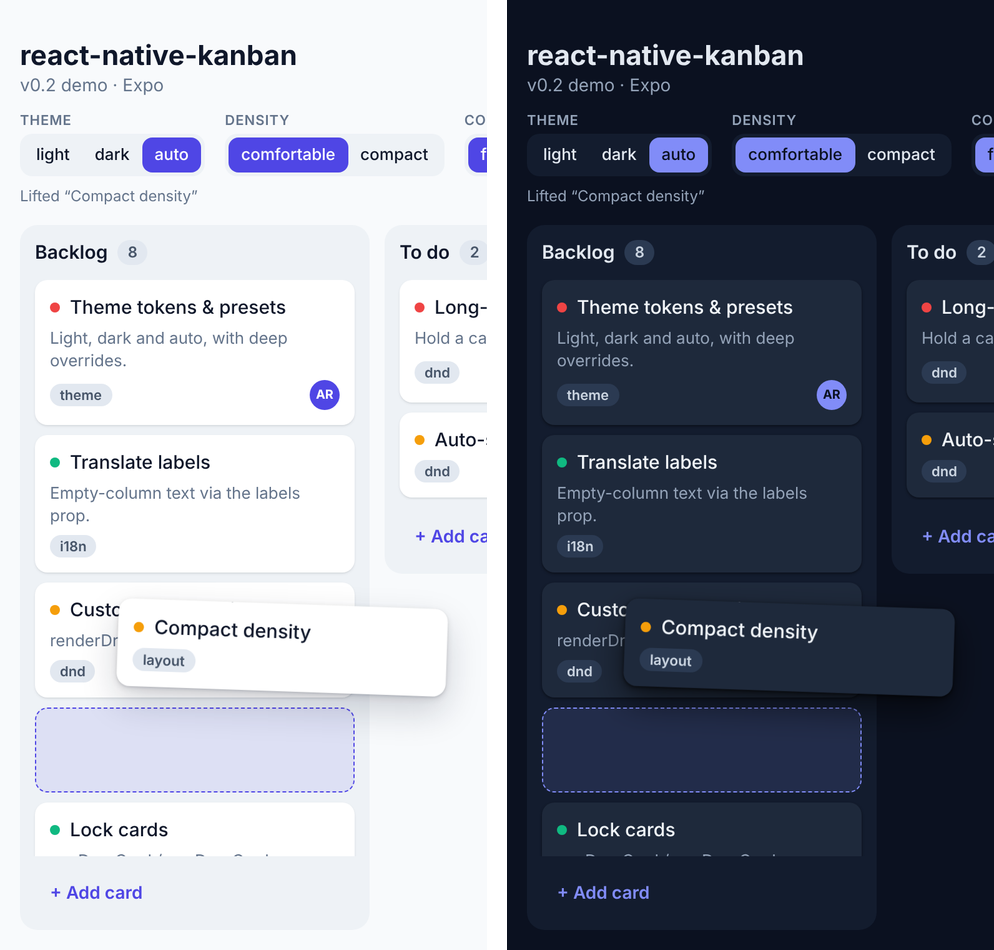

# react-native-kanban

[](https://www.npmjs.com/package/react-native-kanban)
[](https://github.com/AbadurRehman/react-native-kanban/actions/workflows/ci.yml)
[](./LICENSE)

Customizable drag-and-drop Kanban board for React Native, built on [Reanimated](https://docs.swmansion.com/react-native-reanimated/) and [Gesture Handler](https://docs.swmansion.com/react-native-gesture-handler/). Inspired by [react-kanban](https://github.com/lourenci/react-kanban), so the data model will feel familiar if you've used it on the web.

> ⚠️ **Work in progress.** `0.2.x` adds long-press drag and drop. Drag customization (custom previews, locked cards) lands in `0.3.0`. See the [roadmap](#roadmap).

<p align="center">
  
</p>

## Goals

- 🧩 **Pure JavaScript.** No native code of its own. Works with Expo and React Native CLI.
- 🎨 **Fully themeable.** Theme tokens, light/dark/auto presets, per-part style overrides and render props.
- 🚀 **UI-thread drag & drop.** Long-press to drag, auto-scroll, smooth reordering on Reanimated 4.
- 🔁 **react-kanban–style API.** Controlled and uncontrolled modes plus pure helpers (`moveCard`, `addCard`, …).
- ♿ **Accessible.** Screen-reader actions for moving cards (planned for v1).

## Installation

```sh
npm install react-native-kanban react-native-reanimated react-native-worklets react-native-gesture-handler
```

| Peer dependency                | Supported  |
| ------------------------------ | ---------- |
| `react-native`                 | New Architecture |
| `react-native-reanimated`      | `>= 4.0.0` |
| `react-native-worklets`        | matching your Reanimated version |
| `react-native-gesture-handler` | `>= 2.20.0` (2.x and 3.x) |

- **React Native CLI:** add `'react-native-worklets/plugin'` as the **last** plugin in `babel.config.js`.
- **Expo (SDK 54+):** no Babel changes needed. Install the peers with `npx expo install`.
- No root view needed: `<Board />` wraps itself in `GestureHandlerRootView`.

## Usage

Long-press a card to pick it up, drag it anywhere, and drop it. The board scrolls on its own when you drag near an edge.

**Uncontrolled:** the board keeps its own state and tells you about changes.

```tsx
import { Board, type KanbanBoard } from 'react-native-kanban';

const initialBoard: KanbanBoard = {
  columns: [
    {
      id: 'todo',
      title: 'To do',
      cards: [{ id: 1, title: 'Design card', description: 'Theme tokens first' }],
    },
    { id: 'done', title: 'Done', cards: [] },
  ],
};

export function TaskBoard() {
  return (
    <Board
      initialBoard={initialBoard}
      onBoardChange={(board) => saveBoard(board)}
    />
  );
}
```

**Controlled:** you own the board and apply each drop, so you can validate it, save it first, or reject it (the card goes back).

```tsx
import { useState } from 'react';
import { Board, moveCard } from 'react-native-kanban';

export function TaskBoard() {
  const [board, setBoard] = useState(initialBoard);

  return (
    <Board
      board={board}
      onCardDragEnd={({ source, destination }) =>
        setBoard((current) => moveCard(current, source, destination))
      }
    />
  );
}
```

The board fills its parent, so give the parent a size (for example `flex: 1`).

### Board props

| Prop | Type | Default | Description |
| --- | --- | --- | --- |
| `board` | `KanbanBoard` | | The board to display (controlled). Use either `board` or `initialBoard`. |
| `initialBoard` | `KanbanBoard` | | The starting board; the component keeps its own state (uncontrolled). |
| `onBoardChange` | `(board) => void` | | Uncontrolled only: called with the new board after each drop that changes it. |
| `onCardDragStart` | `({ card, source }) => void` | | A card was lifted. A good place for haptics. |
| `onCardDragEnd` | `({ card, source, destination }) => void` | | A card was dropped. In controlled mode, apply it with `moveCard`. |
| `disableCardDrag` | `boolean` | `false` | Turn off long-press dragging. |
| `theme` | `'light' \| 'dark' \| 'auto' \| KanbanThemeInput` | `'light'` | Preset or custom theme. `'auto'` follows the device. |
| `density` | `'comfortable' \| 'compact'` | `'comfortable'` | Compact tightens spacing and type. |
| `columnWidth` | `number \| 'fullScreen'` | `280` (`240` compact) | `'fullScreen'` shows one column per screen. |
| `columnHeight` | `'content' \| 'fill'` | `'content'` | Size columns to their cards, or stretch them to the board height. |
| `snapToColumns` | `boolean` | `true` for `'fullScreen'` | Snap horizontal scrolling to columns. |
| `showCardCount` | `boolean` | `true` | Count badge next to column titles. |
| `styles` | `KanbanStyles` | | Style overrides for each part (see below). |
| `labels` | `Partial<KanbanLabels>` | | Translatable strings, e.g. `{ emptyColumn: 'Sin tarjetas' }`. |
| `renderCard` | `(card, { column, index, theme }) => ReactNode` | | Replace the default card. |
| `renderColumnHeader` | `(column, { index, cardCount, theme }) => ReactNode` | | Replace the title + count header. |
| `renderColumnFooter` | `(column, info) => ReactNode` | | Render under a column's cards, e.g. an "Add card" button. |
| `renderEmptyColumn` | `(column, info) => ReactNode` | | Replace the "No cards" placeholder. |
| `onCardPress` | `(card, { column, index, theme }) => void` | | Makes cards accessible buttons. A press that turns into a drag doesn't count as a tap. |
| `style` | `StyleProp<ViewStyle>` | | Outer container style. |

Wrap render props in `useCallback` so unchanged columns and cards skip re-rendering.

## Drag and drop

- **Lift:** press and hold a card for 300 ms. Moving your finger before that scrolls instead, so drags and scrolls don't fight.
- **Move:** the card follows your finger on the UI thread. A dashed landing spot opens where it will go, and the other cards slide out of the way. Empty columns light up as drop zones.
- **Auto-scroll:** drag near the left or right edge to scroll the board, or near a column's top or bottom to scroll that column.
- **Drop:** the card glides into its spot. `source` and `destination` use the same shape as `moveCard`:

```ts
onCardDragEnd={({ card, source, destination }) => {
  // source:      { fromColumnId: 'todo', fromPosition: 0 }
  // destination: { toColumnId: 'done', toPosition: 2 }
}}
```

When a card is dropped where it started, `destination` equals `source`.

**Haptics.** The library adds no dependencies, so trigger them from the callbacks:

```tsx
import * as Haptics from 'expo-haptics';

<Board
  initialBoard={board}
  onCardDragStart={() => Haptics.impactAsync(Haptics.ImpactFeedbackStyle.Medium)}
  onCardDragEnd={() => Haptics.selectionAsync()}
/>;
```

During a drag nothing re-renders: React renders once when the card lifts and once when it drops. Everything in between runs on the UI thread.

## Theming

Pick a preset, or pass a theme object. Nested tokens are merged into the preset, so you only override what you need:

```tsx
<Board
  board={board}
  theme={{
    base: 'auto', // 'light' | 'dark' | 'auto'
    colors: { accent: '#7C3AED' },
    typography: { cardTitle: { fontFamily: 'Inter-SemiBold' } },
    radius: { card: 6 },
    dark: { colors: { background: '#000000' } }, // only in dark mode
    light: { colors: { background: '#FFFFFF' } }, // only in light mode
  }}
  density="compact"
/>
```

| Token group | Keys |
| --- | --- |
| `colors` | `background`, `column`, `columnTitle`, `card`, `cardTitle`, `cardDescription`, `countBadge`, `countBadgeText`, `border`, `accent`, `onAccent`, `emptyColumnText`, `placeholder` |
| `spacing` | `boardPadding`, `columnGap`, `columnPadding`, `cardGap`, `cardPadding` |
| `radius` | `column`, `card`, `badge` |
| `typography` | `columnTitle`, `cardTitle`, `cardDescription`, `countBadge`, `emptyColumn` (each a text style: `fontFamily`, `fontSize`, `fontWeight`, `lineHeight`, …) |
| `shadows` | `card`, `cardDragging` (any view style, e.g. `boxShadow` or `elevation`) |

Custom cards can match the board, including live light/dark switching, with `useKanbanTheme()`:

```tsx
function TaskCard({ task }: { task: Task }) {
  const { colors, radius, spacing, typography } = useKanbanTheme();
  return (
    <View style={{ backgroundColor: colors.card, borderRadius: radius.card, padding: spacing.cardPadding }}>
      <Text style={[typography.cardTitle, { color: colors.cardTitle }]}>{task.title}</Text>
    </View>
  );
}

<Board board={board} renderCard={(task) => <TaskCard task={task} />} />;
```

Need the same colors outside the board (headers, status bar)? `createKanbanTheme(theme, { systemColorScheme, density })` returns the resolved theme, and `lightTheme` / `darkTheme` are exported as plain objects.

### Style overrides

For one-off tweaks without a custom theme, `styles` targets each part of the board:

```tsx
<Board
  board={board}
  styles={{
    column: { borderWidth: 1, borderColor: '#E5E7EB' },
    columnTitle: { textTransform: 'uppercase', letterSpacing: 0.5 },
    card: { borderRadius: 4 },
  }}
/>
```

Keys: `boardContent`, `column`, `columnHeader`, `columnTitle`, `countBadge`, `countBadgeText`, `columnContent`, `columnFooter`, `card`, `cardTitle`, `cardDescription`, `emptyColumn`, `emptyColumnText`, `placeholder` (the landing spot), `dragOverlay` (the lifted card's wrapper).

## Helpers

Pure functions that return a new board. They never mutate their input, keep unchanged columns' object identity (so memoized columns skip re-rendering), and return the same board when nothing changes.

| Helper | Example |
| --- | --- |
| `moveCard(board, source, destination)` | `moveCard(b, { fromColumnId: 'todo', fromPosition: 0 }, { toColumnId: 'done', toPosition: 0 })` |
| `moveColumn(board, source, destination)` | `moveColumn(b, { fromPosition: 0 }, { toPosition: 2 })` |
| `addCard(board, columnId, card, { position? })` | `addCard(b, 'todo', { id: 9, title: 'New' }, { position: 'top' })` |
| `removeCard(board, cardId)` | `removeCard(b, 9)` |
| `updateCard(board, cardId, patch \| updater)` | `updateCard(b, 9, { title: 'Renamed' })` |
| `addColumn(board, column, { position? })` | `addColumn(b, { id: 'qa', title: 'QA', cards: [] })` |
| `removeColumn(board, columnId)` | `removeColumn(b, 'qa')` |
| `updateColumn(board, columnId, patch \| updater)` | `updateColumn(b, 'qa', { title: 'Review' })` |
| `findCard(board, cardId)` | `findCard(b, 9)` returns `{ card, columnId, columnIndex, position }` |

`position` is `'top'`, `'bottom'` (default) or an index.

## Data model

```ts
import type { KanbanBoard } from 'react-native-kanban';

const board: KanbanBoard = {
  columns: [
    {
      id: 'todo',
      title: 'To do',
      cards: [{ id: 1, title: 'Design card', description: 'Theme tokens first' }],
    },
    { id: 'done', title: 'Done', cards: [] },
  ],
};
```

Add your own fields with generics:

```ts
interface TaskCard extends KanbanCard {
  priority: 'low' | 'medium' | 'high';
}

const board: KanbanBoard<TaskCard> = { columns: [] };
```

Data types: `KanbanBoard`, `KanbanColumn`, `KanbanCard`, `KanbanId`, `CardSource`, `CardDestination`, `ColumnSource`, `ColumnDestination`. Event types: `CardDragStartEvent`, `CardDragEndEvent`.

## Roadmap

- [x] **0.0.x: Setup.** Library scaffold, React Native CLI + Expo example apps, CI, data model types.
- [x] **0.1.0: Static board + theming.** `<Board />`, theme presets, style overrides, render props, layout options, helpers.
- [x] **0.2.0: Card drag & drop.** Long-press drag, placeholder, auto-scroll, controlled/uncontrolled, callbacks.
- [ ] **0.3.0: Drag customization.** `dragStyle`, custom drag preview/placeholder, `canDragCard`/`canDropCard`.
- [ ] **0.4.0: Columns & scale.** Column reordering, virtualization, 500+ card benchmarks.
- [ ] **1.0.0: Polish.** Accessibility, RTL, tablets, web demo, migration guide from react-kanban.

## Example apps

This repo has two example apps that use the library straight from `src/`. Both render the same demo from [`example-shared/`](./example-shared): drag cards around, add cards, and switch theme, density, column width/height, dragging and card style at runtime. The line under the controls shows the last drag or tap event.

| App | Folder | Run |
| --- | --- | --- |
| React Native CLI | [`example/`](./example) | `yarn example android` / `yarn example ios` |
| Expo | [`example-expo/`](./example-expo) | `yarn example:expo android` / `yarn example:expo ios` / `yarn example:expo web` |

CI builds both apps on Android and iOS, plus the Expo app for web, on every PR.

## Contributing

- [Development workflow](CONTRIBUTING.md#development-workflow)
- [Sending a pull request](CONTRIBUTING.md#sending-a-pull-request)
- [Code of conduct](CODE_OF_CONDUCT.md)

## License

MIT © [Abad](https://github.com/AbadurRehman)

---

Made with [create-react-native-library](https://github.com/callstack/react-native-builder-bob)
